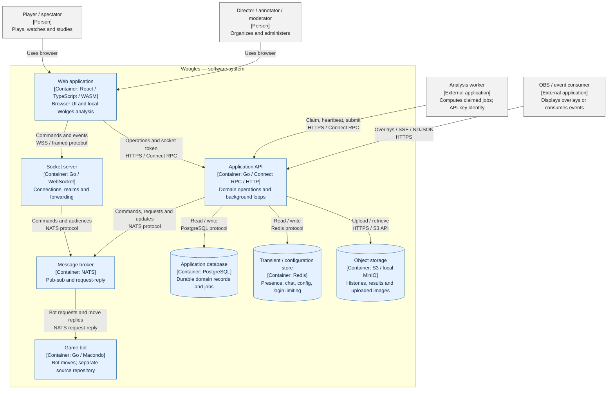

# Container architecture — C4 level 2

## Scope and notation

This is a logical runtime view of the Woogles software system, reconstructed from E01–E09 in the [evidence index](evidence.md). A container means an executable application or data store in C4, not necessarily a Docker container. Blue containers belong to Woogles; grey boxes are people or external applications. Supporting jobs and optional integrations are detailed below to keep the main view readable. The diagram uses Mermaid flowchart syntax with explicit C4 types, technologies, responsibilities and a software-system boundary; this avoids overlapping labels in Mermaid's experimental C4 renderer.

The frontend runs in the user's browser. Its static delivery infrastructure is deliberately described separately: development uses Rsbuild behind Traefik, while the deployment workflow uploads built files to S3. The repository does not establish a complete production ingress topology.

## Main runtime

Relationships indicate the caller's dependency, except the broker-to-bot arrow which follows request delivery. Request responses and subscribed events travel back along the same connection. HTTPS/WSS describe the public-facing intent; local Compose uses HTTP/WS. The bot is a Woogles runtime dependency even though its implementation is outside this repository. The analysis worker is an external application because this repository provides its protocol and queue server, not its executable. [E01–E06, E09]

## Container responsibilities and source of truth

| Container | Responsibilities and interfaces | Evidence |
| --- | --- | --- |
| Web application | React routes, Connect clients, socket state, game/editor/broadcast/competition pages. Wolges WASM and its Web Worker provide position analysis, simulations and endgames inside the browser. The worker is part of the web container, not a server service. | E01, E06 |
| Application API | `cmd/liwords-api`; registers 23 RPC services plus HTTP routes. Owns gameplay, matching, competitions, accounts, puzzles, editorial work and broadcasts. Bus handlers, broadcast polling, analysis-job reclaim, VDO polling and other loops run inside this process. | E02, E03 |
| Socket server | `cmd/socketsrv`; `/ws` on default port 8087. Validates connection tokens, manages connection IDs and realms, forwards protobuf payloads to NATS and routes audience events back to clients. Domain validation remains in the application API. No direct PostgreSQL or Redis connection is wired here. | E04 |
| NATS | Shared transport for socket/API communication, user/game/tournament audiences, bot request-reply and invalidation/notification subjects. This wiring uses core NATS subscriptions; it does not configure a durable JetStream event store. | E03, E04 |
| PostgreSQL | Users/sessions/RBAC, seeks, games and turn rows, game documents, tournaments, leagues, puzzles, analysis jobs, collections, comments, broadcasts and integrations. SQLC queries and specialized store wrappers share the database. | E05, E10–E19 |
| Redis | Chat history and channel metadata, presence, application configuration, login limiting. It is not the authoritative native-game position store. | E05, E17, E18 |
| Object storage | Distinct configured buckets for completed-game histories, analysis results, public avatars and identity-verification images. Results and histories are application data, not merely disposable caches. The website's static bucket is a separate delivery concern. | E02, E08, E09, E18 |
| Game bot | Macondo `cmd/bot`, launched by Compose or separately. The API requests a move over NATS and applies the response through gameplay logic. Optional WordSmog support uses the commented-out Wolges AWSM HTTP service. | E01, E03 |

The class named `game.Cache` no longer caches mutable games: it passes position reads through to PostgreSQL and retains a short-lived active-games listing. Current native position loads use serialized `games.history`, or S3 history where an archive key is present; **serving positions reconstructed from `game_turns` is commented out**. Dual-written turns, shadow comparisons and optional `ongoing_games` writes/listings are migration mechanisms controlled by flags. Neither `xwordgame` nor `cwgame` is a separate deployed container. [E08]

## Supporting applications and deployment variants

| Application / infrastructure | Invocation and connections | Status in the repository |
| --- | --- | --- |
| Maintenance executable | `cmd/maintenance` reads configured stores and invokes selected maintenance operations: season lifecycle/reminders, archive sweep, session/user cleanup, integration refresh, badges and blog feed updates. Some tasks also call the API or third parties. | Runnable Go image; needs an external scheduler/operator. Exact production schedules are not defined here. E07 |
| Puzzle generator | API `StartPuzzleGenJob` invokes a configured ECS task; `cmd/puzzlegen` consumes a generation request and stores selected positions, source games and generation logs through initialized stores. | Separate batch executable/image; not an API goroutine. E07, E14 |
| COP pairing function | API `PairService.HandlePairRequest` invokes the configured Lambda, whose handler delegates to Go pairing logic. | `services/cop-lambda`; optional remote calculation. This is distinct from live-game matchmaking. E07, E11 |
| Tournament PDF function | Tournament API invokes a configured Lambda to produce scorecards, optionally with QR codes. | Python service under `services/tourneypdf`; SAM definition. E07, E11 |
| Database migration task | API executable can run migrations and quit before starting its server. | Workflow runs a separate ECS migration task; local Compose enables startup migration. E01, E02, E07 |
| Static web hosting / local dev server | Built JS/CSS/WASM/data are delivered to the browser. | Workflow uses S3 upload; Compose uses Rsbuild on 3000 and Traefik on 80. Exact production CDN/load balancer configuration is not supplied. E01, E07 |
| Telemetry backend | API exports OpenTelemetry traces; Compose offers Jaeger. | Development topology is explicit; production exporter configuration is external. E01, E02 |

These are all C4 containers or infrastructure dependencies, but expanding every optional path in the main diagram would obscure the interactive system. Operator utilities, backfills, repair tools and the league tester under `cmd/` are offline administration tools, not additional always-running domain services.

## External integrations

| External system | Direction and purpose | Owning capability / source |
| --- | --- | --- |
| Amazon SES | API/maintenance → SES over HTTPS; transactional email. | Registration, authentication, leagues; `pkg/emailer/ses.go`. E18 |
| Discord | Application notifications/webhooks; also CI notifications outside the product runtime. | `pkg/notify`, tournament notices and deployment scripts. E19 |
| Patreon / Twitch | OAuth callbacks and outbound API/token refresh requests. Patreon data supports subscription-derived permissions, badges and bot allowances. | `pkg/integrations`, `pkg/entitlements`, maintenance refresh. E19 |
| Membership/title providers | Application → organization provider APIs/data to link memberships and refresh titles; verification supports administrative review. | `pkg/organization`, `pkg/integrations/organizations`, `pkg/verification`. E18 |
| Tournament feeds | API poller → configured feed URL; persist the fetched feed and polling status. Request paths use stored feed data. | Broadcasts, including TSH/other supported feed adapters. E16 |
| OBS | Browser sources → API pages and Server-Sent Events. Personal slots can follow event slots or the user's annotation activity. | `pkg/broadcasts/obs_handler.go`, local streaming manual. E16 |
| VDO.Ninja | Webhook → API; API polls active monitoring streams. Video does not travel through NATS as gameplay data. | Tournament monitoring; `pkg/vdowebhook`. E19 |
| Cloudflare Turnstile | Browser supplies challenge token; API → verification endpoint when configured. | Human check; `pkg/humancheck`. E18 |
| Stripe | Browser → Stripe checkout for donations. | `liwords-ui/src/donate.tsx`; no backend payment ledger is established by this integration. E19 |
| Blog RSS | Maintenance → Woogles blog feed; application configuration surfaces content. | `cmd/maintenance/main.go`. E07 |

## Important runtime paths

1. **Read or administrative command:** browser → API Connect handler → domain/service logic → PostgreSQL/Redis/S3; relevant changes may also publish to NATS.
2. **Live move:** browser → socket → NATS → API bus → gameplay validation and database-backed game lock → persistence → audience updates over NATS/socket. Bots use the same authoritative gameplay path after a NATS reply.
3. **Volunteer analysis:** worker → API claim endpoint → PostgreSQL queue; worker computes externally, heartbeats and submits to API; API stores result in S3, updates job metadata in PostgreSQL and notifies through NATS.
4. **Broadcast:** API background poller claims a due event in PostgreSQL, fetches its feed and saves a snapshot. Annotators update GameDocuments. OBS HTTP/SSE endpoints combine those documents with slot assignments and NATS updates.

The transport is not an event-sourced domain architecture. Database writes and NATS publication are not one atomic operation; game completion also spans ratings, competition results, statistics, standings and archival. Consult the [consistency model](domain/model.md) before assuming delivery or transactional guarantees.
