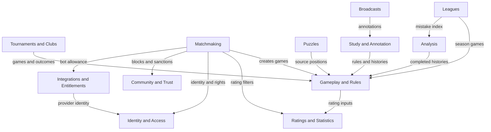

# Domain contexts and functionality

## Domain purpose

Woogles lets people play crossword board games, organize competition, improve their play, and present games to an audience. A useful domain split follows those activities rather than Go package names. This document proposes **12 bounded contexts**; their boundaries and strategic classifications are inferred from the implementation. Most run in one API process and share PostgreSQL, protobuf types and store access. [E02, E05, E06]

## Capability and ownership map

“Core” identifies the platform's distinctive game/competition behavior; “supporting” identifies capabilities that enable it. This is an analytical classification, not a statement about business priorities agreed with stakeholders.

| Context | Purpose and principal capabilities | Owns the meaning of | Implementation / storage |
| --- | --- | --- | --- |
| **Gameplay and Rules** — core | Play human/bot games in real time or correspondence; validate moves, challenge words, time turns, resign, abort or adjudicate; expose history/metadata/export. | Native Game, Position, Move, Turn, Challenge, Clock, Game Outcome, Game Settings. | `pkg/gameplay`, Macondo, `pkg/entity/game.go`; annotation rules in `pkg/cwgame`; `pkg/xwordgame`/`xwordbridge` migration; `games`, `game_turns`, optional `ongoing_games`, S3 histories. E08, E13 |
| **Matchmaking** — core | Publish open seeks, invite a named opponent, accept/decline/cancel, rematch, enforce rating/follow/block requirements and bot access. | Sought Game, Seek, Match Request, Acceptance, Rematch Streak. | `pkg/bus/meseeks.go`, `pkg/matching`, `pkg/stores/soughtgame`; `soughtgames`. E10 |
| **Tournaments and Clubs** — core | Maintain clubs and child sessions; manage tournament metadata, directors, divisions, entrants, check-in, round controls, pairings, online games or IRL results, standings, exports and scorecards. | Tournament, Club, Club Session, Tournament Division, Round, Pairing, Result, Director. | `pkg/tournament`, `pkg/pair`, tournament/IPC protocols; `tournaments`, director/entry/readiness tables; division-manager data; optional Lambda functions. E11 |
| **Leagues** — core | Run recurring correspondence seasons; manage registration, placement and promotion/relegation, division pairings, deadlines, standings, reminders and administration. | League, Season, Season Registration, League Division, Standing, Placement Outcome. | `pkg/league`, injected game-creation/standings adapters; `leagues`, `league_seasons`, `league_divisions`, `league_registrations`, `league_standings`; references on games. E12 |
| **Ratings and Statistics** — supporting | Rate completed rated games, track uncertainty and per-mode history, compute game/profile statistics and leaderboards; provide rating inputs for matching and placement. | Rating Pool, Rating, Rating Deviation, Profile/Game Statistics. | `pkg/glicko`, `pkg/stats`, `pkg/entity/ratings.go`, gameplay completion; profile ratings/stats and statistical projections. This is currently a cross-cutting responsibility, not an isolated module. E13 |
| **Puzzles** — supporting | Generate training positions from games or bot games, select a next puzzle, record attempts, reveal solutions, adjust solver/puzzle ratings, vote and inspect generation logs. | Puzzle, Puzzle Attempt, Solution, Puzzle Rating, Generation Job. | `pkg/puzzles`, `cmd/puzzlegen`, `pkg/stores/puzzles`; puzzle, attempt, tag/vote and generation-log tables. E14 |
| **Analysis** — supporting | Request completed-game analysis, apply quotas, allocate work to API-key volunteers, heartbeat/reclaim jobs, validate/store results and expose progress/admin statistics. Browser tools also analyze positions locally. | Analysis Request, Analysis Job, Claim, Analysis Result, Mistake Index. | `pkg/analysis`, queue SQL, S3 result store; frontend WASM is a separate execution mode with no server job. E06, E09 |
| **Study and Annotation** — supporting | Create/import/edit annotated games, amend moves/racks, mark annotation done, browse/embed/export, organize native/annotated games into ordered collections, and discuss game turns in comments. | Annotated Game, GameDocument, Annotator, Annotation Done, Collection, Chapter, Game Comment. | `pkg/omgwords`, `pkg/cwgame`, `pkg/collections`, `pkg/comments`, `pkg/embed`, `pkg/memento`; `game_documents`, `annotated_game_metadata`, `collections`, `collection_games`, `comments`. E15 |
| **Broadcasts** — supporting | Configure a broadcast event/feed; persist tournament feed snapshots; claim tables for annotation; manage directors, event slots and personal stream slots; render overlays and broadcast statistics. | Broadcast Event, Feed Snapshot, Broadcast Game/Table Claim, Broadcast Slot, Stream Slot. | `pkg/broadcasts`; broadcasts/directors/games/slots/feed tables and `user_obs_slots`; HTTP/SSE overlays. E16 |
| **Identity and Access** — supporting | Register/verify email, sign in/out, recover passwords, manage sessions/API keys, profiles/avatars and roles/permissions; link organization identities, review verification and refresh titles. | User, Profile, Session, Role, Permission, Organization Membership, Verification Request. | `pkg/auth`, `registration`, `profile`, `organization`, `verification`, `sessions`; users/profiles/sessions/RBAC and verification/provider records; S3 uploads. E18 |
| **Community and Trust** — supporting | Follow/block, chat and show presence; moderate messages/accounts/play access, track notoriety and apply automatic rated-play sanctions; revoke suspended sessions. | Follow, Block, Chat Channel/Message, Presence, Moderation Action, Notoriety. | `pkg/user/services`, `pkg/bus/chat.go`, `pkg/mod`, Redis chat/presence, PostgreSQL user relationships/actions/notorious games. Social interaction and moderation are distinct subdomains grouped here for a pragmatic overview. E17 |
| **Integrations and Entitlements** — supporting | Link Patreon/Twitch accounts, refresh provider state, derive subscriber badges and BestBot allowances, adapt organization data and monitoring feeds; initiate donation checkout. | Provider Integration, Paid Tier, Entitlement, Allowance/Usage. | `pkg/integrations`, `pkg/entitlements`, maintenance refresh; integration and entitlement queries, badges/RBAC links; donation UI. E19 |

Application configuration, telemetry, deployment, email transport and scheduled invocation are **generic technical capabilities**, not additional business aggregates. `WordService` supplies word validity, definitions and anagram queries from lexical resources; it supports gameplay/study without owning the actual move lifecycle. [E02, E07]

## Context map

Arrows name a principal dependency from the consuming context toward the provider. They do not denote a network request or transaction. The map is selective; the table below also describes callbacks and shared dependencies.

### Relationship patterns and actual coupling

| Relationship | DDD interpretation | Implementation reality |
| --- | --- | --- |
| All contexts ↔ identity | Shared user identity; contexts refer to a user by stable ID and apply their own roles/policies. | User/store types and authorization helpers are reused directly; the `entity.User` model is shared, not isolated per context. |
| Matchmaking → gameplay | Game creation is the downstream outcome of accepting a proposal. | Bus code consumes a seek and invokes gameplay creation. Seek consumption and game creation are separate operations. |
| Competition ↔ gameplay | Competition defines who plays and under which settings; gameplay provides outcomes. | Direct calls and injected adapters. Completion calls tournament logic or the league standings updater; there is no independent competition service subscription. |
| Gameplay → ratings/trust | An outcome supplies input for rating/statistics and conduct assessment. | `end.go` performs these effects synchronously/in sequence; automod excludes tournament games in this path. |
| Broadcasts ↔ annotation | Broadcasts select an event table and create/follow its editable game; annotation completion changes broadcast state. | Shared GameDocument types plus `SetAnnotatedGameDoneHook`, NATS activity messages and direct store access. |
| Analysis → leagues | Completed analysis supplies mistake-index statistics. | Result submission starts a best-effort league-statistics refresh. |
| Third parties → integrations → domain | Provider adapters act as an **anti-corruption layer candidate**: translate external membership/subscription/feed data into local terms. | Adapters exist, but provider names and data still surface in entitlements and authorization. This is not a perfectly isolated boundary. |
| API ↔ browser/socket | Protobuf contracts are a published application language. | Shared generated types and transport messages are not a separate domain model per context. |

## Important overlaps to preserve explicitly

- **Gameplay vs annotation:** native `entity.Game` wraps Macondo. Annotation uses `ipc.GameDocument` and `cwgame` through `GameEventService`. A shared “game” URL/ID does not imply identical lifecycle or ownership rules.
- **Tournaments vs leagues:** both group players and results, but tournament rounds/director controls differ from recurring league seasons, placement and deadline closure. Do not merge their divisions into one aggregate.
- **Ratings vs standings:** a rating estimates strength in a rating pool; a standing ranks a participant inside a competition. League mistake index is an analysis metric, not another skill rating.
- **Community vs transport:** a chat channel is a social concept. A socket realm/audience is delivery infrastructure. Presence can change because a tab changes route without changing the underlying user account.
- **Organization vs club:** an organization is an external membership/title source; a club is a Woogles competition space that can spawn sessions.
- **Server vs browser analysis:** local simulations are interactive computations; submitted server analysis is tracked work with claims, results and quotas.

These distinctions are the principal reasons to retain separate language boundaries even where the current code shares structures.
