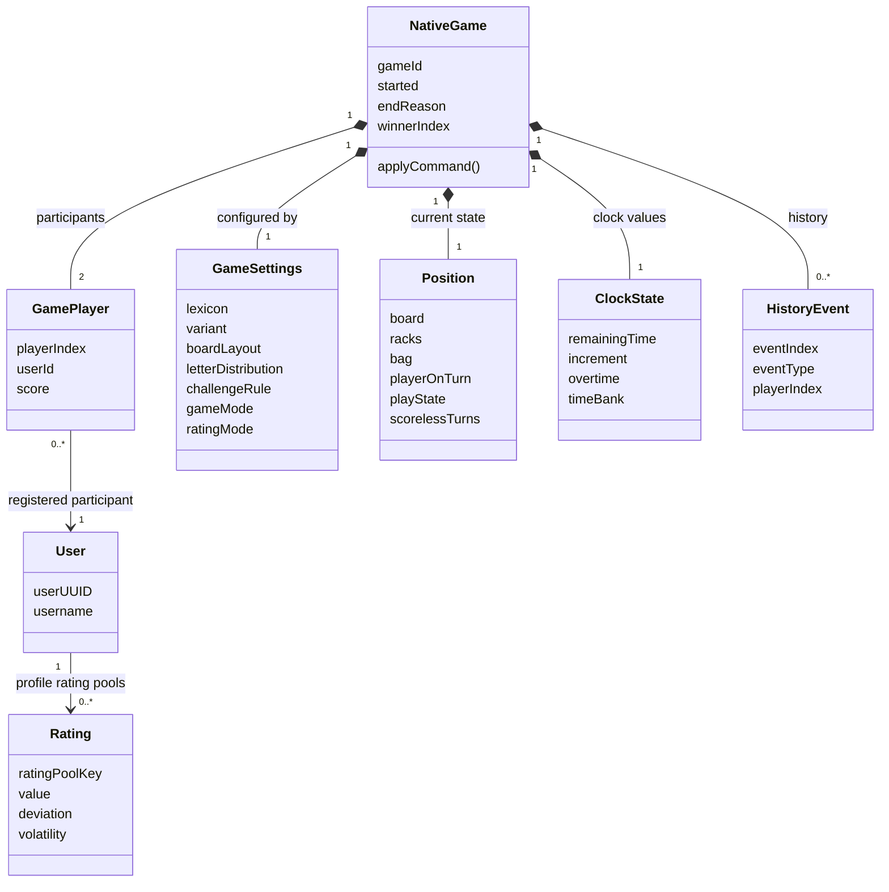
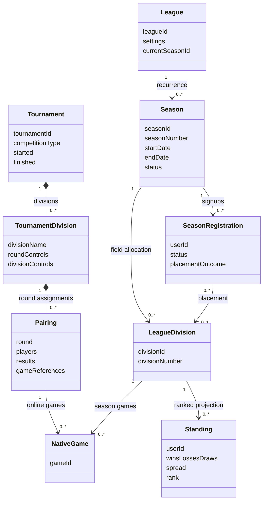

# Domain model: structure, rules and consistency

This is a domain interpretation of the implementation, not a class-for-class translation or an exhaustive database ERD. Entity identity persists across changes; a value object is defined by its values; an aggregate candidate groups state that should remain consistent under a root. The aggregate candidates below are **inferred**. Only explicitly described transactions/locks are observed guarantees. Evidence references resolve in the [source index](../evidence.md).

Value-object candidates include **GameSettings** (rules choices, excluding request-tracking IDs), **RatingPoolKey**, **Rating** (value/deviation/volatility), **GameOutcome** (end reason and winner), **TimeControl**, and board coordinates/tile encodings. They describe values rather than independent lifecycles. Game, User, Season, Puzzle and Collection instead retain an identity as their state changes. Current protobuf/Go structs can mix these roles; the classification describes domain meaning rather than asserting immutable implementation types.

## 1. Gameplay concepts

The diagram is conceptual: Position is embedded engine state rather than a separately stored ORM entity, and ClockState includes configuration as well as mutable clock values. Anonymous identities have reduced profile/rating capabilities. A bot is represented by a user marked as an internal bot. Annotated-game player names can describe people with no Woogles account; they do not inherit the native-game User association. [E08, E13, E18]

**Game configuration has independent dimensions.** Game type distinguishes native, annotated and bot-vs-bot provenance. Game mode distinguishes real-time from correspondence. Variant distinguishes rules such as classic/WordSmog/super variants. Rating mode distinguishes rated from casual. Lexicon identifies accepted words; letter distribution defines tiles and their points/counts; board layout defines geometry/premiums. One “language” field cannot replace these concepts. [E10, E13]

**A command, a turn and a history event are different.** A placement/challenge command can produce several recorded events, including returned tiles, bonuses, lost turns and end-rack adjustments. A zero-based event index is not necessarily the same as a player's turn count. The final pass/challenge opportunity after a player empties a rack must survive reconstruction as play state; reconstructing only visible placements loses this information. [E08, E13]

## 2. Competition relationships

Composition under Tournament reflects its serialized division-manager model, not a guarantee that all related readiness/director/entry rows commit together. A Pairing can contain multiple game records and can also represent an IRL result, bye or forfeit without a native online game. League associations refer to separately persisted records; placing every season and game under a single transaction-sized League aggregate would misrepresent the implementation. A club is represented through the tournament competition type and a parent/child relationship to club sessions. [E11, E12]

## 3. Aggregate candidates and persistence

| Candidate root | Internal entities / important value objects | References outside the aggregate | Observed persistence / consistency |
| --- | --- | --- | --- |
| **Native Game** | Two participant slots, position/board/racks/bag, clock state, event history, outcome; GameSettings and game ID. | Users, tournament pairing or league/season/division, ratings/statistics. | `games`; staged `game_turns` when enabled; optional `ongoing_games` snapshot/listing; completed archive in S3. Session advisory lock spans load → modify → save; a store transaction writes the game and staged turns together. E08, E13 |
| **Sought Game** | Seeker, optional receiver, readiness/presence states, rating range, followed-only/established restrictions, requested GameSettings. | User/connection IDs, rematch game ID, optional club/tournament ID. | `soughtgames`; atomic claim removes the accepted seek and appropriate competing real-time seeks. Creating the subsequent game is outside that claim transaction. E10 |
| **Tournament** | Metadata, division managers, entrants, controls, pairings/results; director assignments as related authorization data. | User IDs, child/parent tournament, native games, optional monitoring streams. | Tournament row carries serialized division data; related entry/director/readiness tables have independent operations. Store updates/manager checks are narrower than a whole-competition distributed transaction. E11 |
| **League** | Name/slug, settings, active/current-season references. | Seasons, creator user. | `leagues`; seasonal work orchestrates other roots and many games. E12 |
| **Season** | Number, dates/status, promotion formula and lifecycle task progress. | League, divisions, registrations, prior season. | `league_seasons` and task-tracking data; lifecycle runners execute steps with guards. The entire season rollover is not one transaction. E12 |
| **Season Registration** | Participation status, placement, prior rank/seasons away. | User, season, optional assigned division. | `league_registrations`; unique user/season. Suitable separate participation entity rather than copying the User aggregate. E12 |
| **Puzzle** and **Puzzle Attempt** | Puzzle source position, answer/tags/rating; per-solver attempt count, nullable completion result and rating snapshots. | Source game/turn, solver user, generation log. | Puzzle and user attempt are separate identities. Submission transaction may write puzzle rating, profile rating and attempt together: current implementation crosses the conceptual boundary. E14 |
| **Analysis Job** | Queue status, priority/configuration, claim owner/times, retries, failure, result reference and summary. | Game ID, requesting/worker user, S3 result. | `analysis_jobs`; SQL claim via `FOR UPDATE SKIP LOCKED`; ownership-checked completion; result object upload precedes metadata update. E09 |
| **Annotated Game** | GameDocument, metadata, named players, events/racks/position, annotation-done flag, visibility metadata. | Creator, broadcast claim, collections and comments. | `game_documents`, `annotated_game_metadata` and metadata in `games`; owner-gated editing, without a document read/modify/write lock. Document schema version/migration is not concurrency versioning. E15 |
| **Collection** | Title/description/listing visibility, ordered chapters with title and game reference. | Creator, native or annotated game ID. | `collections`, `collection_games`; mutation ownership checks; duplicate chapter/game constraints. Chapters do not own the referenced game's lifecycle. E15 |
| **Game Comment** | Text, author, game/turn reference, timestamps. | User and game; collection discussion is a view of comments on member games. | `comments`; independent add/edit/delete operations. E15 |
| **Broadcast Event** | Metadata, source feed settings and directors; broadcast table claims and event slots are related entities. | Annotated game, annotator, optional Woogles tournament. | `broadcasts`, `broadcast_games`, `broadcast_directors`, slot tables; `broadcast_feeds` is a durable fetched read model. Polling uses a DB claim; short response caches use version keys. E16 |
| **Personal Stream Slot** | User-owned name and mode: follow a broadcast slot or annotation activity. | User, broadcast/slot or currently selected annotated game. | `user_obs_slots`; separate lifecycle from an event-owned Broadcast Slot. E16 |
| **User** | Account identity, credentials/email verification, profile values; ratings/stats are currently embedded profile data. | Sessions, roles, social links, organization/provider identities. | `users`, `profiles`; supporting records have independent operations. Do not assume the User root atomically owns every row referring to the user. E18 |
| **Session / Verification Request / Moderation Action / Integration** | Session expiry/token; review evidence/status; sanction scope/duration; provider state/credentials. | User, reviewing actor, organization/provider, object references. | Separate relational records; action/session propagation can publish via NATS; provider refresh is asynchronous relative to user interaction. E17–E19 |

Ratings and standings are deliberately not listed as one combined aggregate. A **Rating** is a value in a user's rating pool; **Standing** is a rebuildable competition read model. An analysis **Result** is a versioned computation output. A broadcast **Feed Snapshot** is persisted external data, useful when the original feed disappears. None is the authoritative live game position. [E09, E12, E13, E16]

## 4. Important invariants and policies

| Rule / policy | Enforcement and useful implication |
| --- | --- |
| Only an eligible player may apply a native-game command at the appropriate game state. | `HandleEvent` takes a game lock before loading; downstream checks validate participant, turn, play state and command. Socket possession alone is insufficient. E13 |
| Concurrent commands must not overwrite a position derived from a stale read. | PostgreSQL session advisory lock covers load/modify/save across servers; staged turn rows and game row commit together. Application-local mutexes would not provide this guarantee. E08; concurrency/atomicity tests E20 |
| Game history must preserve non-placement events and ending state. | Replay/bridge/archive validation handles adjustments and final-pass state. The disabled served turn-reconstruction path and shadow checks prevent claiming that a turn log already replaces the live model. E08 |
| A game has exactly two native participant slots. | Fixed arrays/indexed players and engine validation; a winner index of `-1` represents a tie. Annotated players have different identity semantics. E08, E13 |
| Overtime and increment cannot both be positive in a new real-time game request. | `ValidateGameRequest`; real-time initial time is at least 15 seconds, increment 0–60 seconds, overtime 0–10 minutes; time bank is correspondence-only. E10 |
| Correspondence is a different clock policy. | Request validation allows 1 hour–5 days initial time, no overtime and a nonnegative bank up to 30 days. `Timers.FillIncrement`/clock calculations define per-turn allowance/refill semantics; labels do not substitute for those calculations. E10, E13 |
| New games require supported, compatible lexical/rules resources. | `AllowedNewGameLexica`, distribution validation and engine initialization. Historical lexica may still be readable without being allowed for new games. E10, E13 |
| Seek acceptance checks the current proposal and relationship constraints. | Matching checks blocks, requested recipient, rating range/establishment, followed-only settings and current gameplay conditions before atomic claim. The claim prevents two successful acceptances of one seek; it does not make all later steps atomic. E10 |
| Rating pools separate modes while normalizing lexicon families. | `ToVariantKey` combines normalized lexicon, variant and time-control category; e.g. NWL versions map to an older canonical key. Display labels and storage keys are not interchangeable. E13 |
| Tournament changes require scoped director authority; rounds must satisfy manager rules. | `authenticateDirector`, classic-division checks and pairing/readiness operations. An IRL result is a competition result, not proof of an online game's move history. E11 |
| A season registration is unique for a user/season; placement is scoped to that season. | Schema uniqueness plus registration/lifecycle checks. Seasons have explicit scheduled/open/active/completed/cancelled statuses; preparation/start/closure enforce transition preconditions. E12 |
| Solving a puzzle and revealing its solution are distinct outcomes. | Attempt `correct` is nullable: null means unresolved; true means solved; false means gave up. An incorrect intermediate answer can leave it unresolved. Submission transaction records first-rated effects and later attempt updates. E14 |
| Server analysis requests require a completed supported game and an authenticated requester, with quota/requeue policies. | Handler permits any authenticated requester; classic/empty variant accepted, other variants rejected. `NOT_A_PLAYER` still exists in the response enum but does not establish current policy. E09 |
| Worker claims and results are controlled server-side. | API-key identity and minimum engine version; atomic job claim, heartbeat/reclaim, result bounds and claim-owner/status check on completion. Stale work can be rejected. E09 |
| Annotation editing is owner-scoped; annotation completion is separate from the recorded game ending. | `failIfSessionDoesntOwn`, GameDocument end reason and annotation metadata `done`; broadcast completion hook runs after marking done. E15, E16 |
| A collection has no duplicate game or chapter number; edits require its owner. | Database unique constraints and service checks. `public` controls discovery/listing behavior; direct `GetCollection` does not enforce an equivalent private-read boundary. E15 |
| Event slots and personal stream slots have different owners. | Broadcast directors configure event slots; a user manages personal stream slots that can follow them. OBS handlers resolve the indirection. E16 |
| Moderation has separate scopes and authority levels. | Actions distinguish chat mute, account suspension, rated/all-game restrictions and privileged destructive/reset actions. Completion automod applies to non-tournament rated games in this path. E13, E17 |

## 5. Consistency and failure boundaries

**Game state is strongly serialized per game, but game completion is a process spanning responsibilities.** `end.go` computes outcome/rating/statistics, emits changes, updates tournament results or automod, saves the game, updates player listings, updates league standings, enqueues league analysis, sends more notifications and starts archival. Some effects precede the final save and several failures are logged. There is no evidence of a transactional outbox or one commit covering all these effects. Local user mutexes used during rating calculation are not a proof of cross-server rating serialization. [E08, E13]

**Game history archival is upload-then-commit.** After a confirmed, validated S3 upload, `CommitArchival` atomically sets the history reference and deletes the archived turn rows. Failure before that point retains the rows; a maintenance sweep can retry. Active native loads still use serialized history; the comment suggesting a turns-first load must be read alongside the commented-out implementation. `DUAL_WRITE_TURNS`, shadow flags and ongoing-game flags are deployment-dependent. [E07, E08]

**Analysis jobs have a durable relational queue; computation is external.** Claim/update conditions provide queue concurrency control. Missing heartbeats lead to retry or failure. Submission stores the result object before completing the owned claim and cleans up an unreferenced result on a lost claim. PostgreSQL and S3 are not in one transaction. A completed zero-turn game can have an empty result with no object. [E09]

**Standings, rankings and live views can lag.** League standings and mistake-index summaries are projections with recalculation paths. Active-game listings have a short cache. Redis presence/chat and NATS updates are not an authoritative ledger of completed games. Broadcast polling saves durable feed snapshots, but update notifications and caches remain separate from their writes. [E08, E09, E12, E16, E17]

**Privacy is contextual.** Opponent-rack censorship, tournament private analysis, annotation private broadcast, collection listing visibility, youth-profile masking and verification-image access solve different problems. Preserve those names and their actual checks; do not generalize them into a universal private/public policy. [E13, E15, E18]

## 6. Domain services and process coordinators

- **Rules services/engines:** Macondo for the authoritative native gameplay path; `cwgame` for GameDocument editing/rules; `xwordgame` plus `xwordbridge` for staged replacement/reconstruction comparisons. Lexicon lookup and letter mapping are shared dependencies.
- **Matching policy/coordinator:** the bus coordinates proposal validation, social/moderation/entitlement checks, seek claim and game creation.
- **Competition services:** division managers calculate pairings/standings; league lifecycle, placement, season orchestration and deadline finishing coordinate many records/games.
- **Rating/statistics services:** calculate derived outcomes and update profile/game projections.
- **Analysis coordinator:** applies request policy, manages durable claims, accepts results and triggers notifications/derived metrics.
- **Broadcast coordinator:** polls external event state, manages claims/slots, creates annotations and resolves overlay sources.
- **Provider adapters:** translate OAuth, membership, subscription and feed data; email/notifications carry side effects rather than define core entities.

These are responsibilities already present in the code. Extracting them into services or repositories would be a separate architecture decision.
