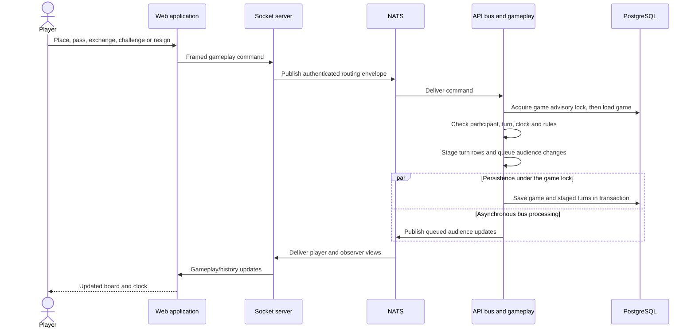
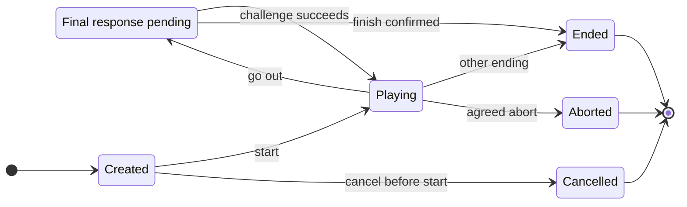
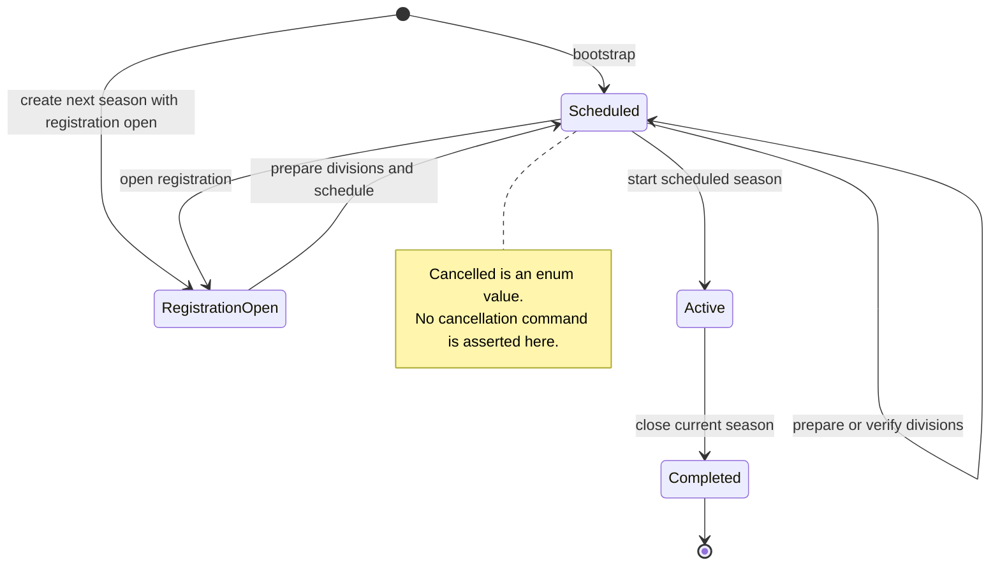
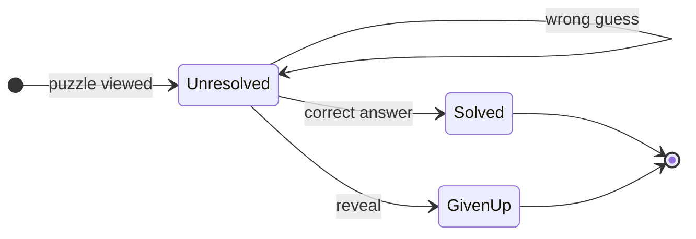
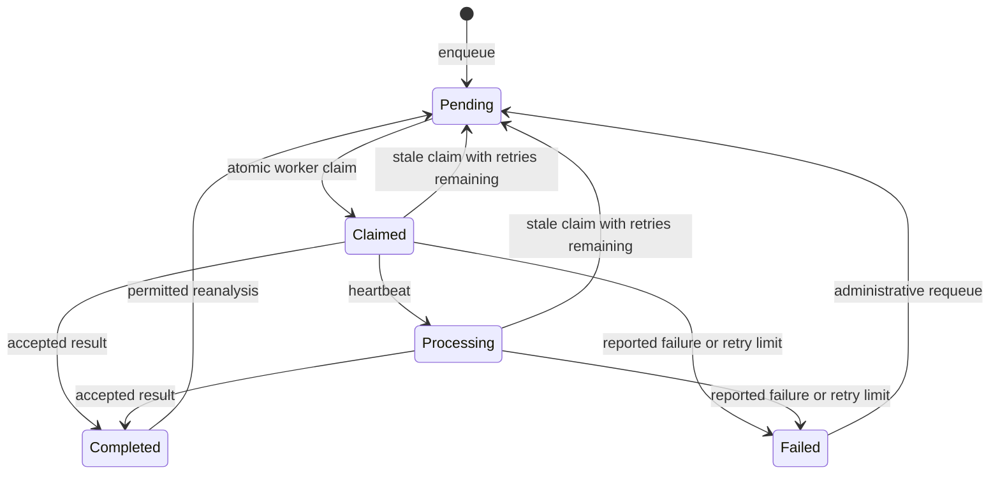

# Workflows, lifecycles and cross-context effects

These traces explain observed behavior at a useful architectural level. They are not exhaustive UI instructions. State names marked **conceptual** summarize multiple fields or code paths; protocol/database names are stated explicitly. Business-fact names are explanatory unless listed as actual messages. Evidence references resolve in the [source index](../evidence.md).

## 1. Find an opponent and start a game

1. A user publishes a seek, names an opponent, requests a bot, or requests a rematch. The server validates GameSettings and relevant account/conduct/entitlement policies.
2. The proposal is stored as a SoughtGame. Open proposals are shown only to eligible viewers; directed requests identify a receiver. Real-time proposals track connections, while correspondence proposals can persist without both players staying connected.
3. Acceptance reloads/checks eligibility: receiver constraints, rating limits, established/followed-only conditions and blocks. Alternative equivalent seeks can be tried if the selected one has already gone.
4. `SoughtGameStore.Claim` consumes the proposal atomically; a second acceptance sees it gone. A real-time acceptance also consumes the seeker's competing real-time proposals. Correspondence redirects cancel conflicting real-time proposals on the affected tabs.
5. The bus instantiates an actual game, removes stale seek presentations and announces the game/redirects to the clients.
6. Real-time play starts through game readiness handling; bots have an immediate-start path. The bus creation path auto-starts correspondence games immediately, skipping the ready flag. [E10, E13]

The claim prevents duplicate consumption. Seek removal, game creation and NATS notification are separate operations; this trace does not imply rollback of a claimed seek if later creation fails.

## 2. Play, challenge and end a native game

This sequence abstracts the normal accepted move; some event construction/publication and end-game effects occur before persistence in the implementation. It is not an assertion of an outbox or save-before-publish guarantee. Spectator/other-player rack visibility is censored according to the relevant rules. The server is authoritative about clock expiration and move legality. [E03, E08, E13]

The **conceptual** game lifecycle is:

`Started`, engine `PlayState` and `GameEndReason` jointly express this lifecycle. Native engine play-state names and `xwordgame.WaitingForFinalPass` are representations of the final challenge/pass opportunity, not new deployed services. A challenge can create multiple history events; game-ending reasons include consecutive zeroes, triple challenge, force forfeit and adjudication. [E08, E13]

At completion, gameplay coordinates ratings/statistics, tournament results or non-tournament rated automod, game/player-listing persistence, league standings, league analysis enqueue, profile/list notifications and background archival. Several effects are best-effort or separately persisted. A league standings processed flag is an application guard; it is not sufficient evidence for exactly-once processing across all retries/restarts. The [consistency section](model.md) describes these limits. [E13]

## 3. Run a tournament or club session

1. An authorized creator creates a tournament or a club session; metadata includes its type, schedule and parent relationship where relevant.
2. Scoped directors manage divisions, entrants/ratings/teams, check-in and game/round controls. Classic division logic calculates or accepts pairings for each round.
3. Starting/opening a round checks its prerequisites. Pairings assign encounters; readiness messages start the assigned online game when applicable.
4. Online outcomes flow from gameplay into tournament result handling. In IRL mode directors/authorized result-entry flows record scores directly; a native-game record is not required for every pairing.
5. The manager updates standings and controls later pairing/start operations. Directors can amend results or perform explicit finish/reset operations with their defined checks.
6. Exports and optional Lambda-generated PDF scorecards support offline competition administration. The separate COP pairing RPC invokes its configured calculation Lambda; this is unrelated to accepting a lobby seek. [E11]

The [IRL guide](https://blog.woogles.io/guides/2025-07-11-using-woogles-for-irl-tournaments/) corroborates the distinction between physical play, entered results and online rounds. Current API/manager checks remain authoritative when the guide's operational instructions differ.

## 4. Run a recurring league season

The database/protocol `SeasonStatus` values are scheduled, registration-open, active, completed and cancelled. Preparation reuses scheduled status; it is not an additional enum value.

1. Administration/lifecycle logic creates the first or next season and opens registration under guarded conditions.
2. Eligible users register once per season. Registration history identifies new/returning players; ratings are input to initial placement, with stability-aware averaging.
3. Preparation checks previous-season completion where required, calculates promotions/relegations/returning-player placement, balances divisions and schedules the field.
4. Start logic verifies prepared divisions and marks the season active/current. A separate caller/season-start manager creates correspondence games through the game-creation adapter. Marking active and creating all games are not one atomic operation.
5. Gameplay outcomes update league standings; league games are enqueued for analysis. Result submission can refresh mistake-index summaries.
6. Lifecycle/maintenance runners send reminders and close overdue seasons. Closure force-finishes/adjudicates remaining games according to policy, checks completion, records placement outcomes and marks the season completed. The next season uses these results. [E12, E13]

Actual runner frequency and production schedules are deployment facts outside this checkout. Administrative tools can recalculate standings/extended statistics and adjust divisions/dates; this is why standings are modeled as a projection rather than the game outcome's sole authority.

## 5. Practice a puzzle

1. A generation job selects suitable positions from stored games or bot-vs-bot games, fills configured buckets and records a generation log.
2. The user selects a lexicon and receives an unseen/unfinished/rating-nearby puzzle according to query policy. Fetching a puzzle can create a per-user attempt record without yet resolving it.
3. The user submits a move or asks to reveal the solution. The puzzle logic compares the intended answer using game/rules helpers rather than treating display text alone as the domain identity.
4. First-rated participation adjusts solver and puzzle ratings; the store writes those values and the attempt together. Later incorrect attempts can increment the count while leaving completion unresolved.
5. A correct answer resolves the attempt as solved; revealing the solution resolves it as given up, even if a supplied answer would otherwise be correct. Subsequent reads show source game/turn, answer and rating snapshots. [E14]

These are attempt states, not states of the Puzzle itself. SQL `correct = NULL / TRUE / FALSE` means unresolved/solved/given-up respectively; the wire `PuzzleStatus` must be interpreted through the service mapping. Anonymous practice does not imply a persisted rated attempt for an anonymous account.

## 6. Request and compute server analysis

1. An authenticated user requests analysis of a completed supported game, including annotated games whose document has an end reason. The requester need not be one of the players. Request quotas, existing-result and supported-variant checks apply.
2. The API creates/reuses an appropriate durable queue job; league completion also has an automatic enqueue path.
3. A compatible external Macondo worker authenticates with a user API key, claims a job and receives computation configuration. SQL atomically allocates pending work and limits active claims per worker.
4. Heartbeats mark processing and retain ownership. Missing heartbeats permit reclaim, increment retries and eventually fail work after the configured retry policy.
5. Submission validates engine/result bounds and claim ownership, uploads a nonempty result to object storage, and conditionally completes the owned claim in PostgreSQL. Lost claims are rejected and unreferenced uploaded objects are cleaned up.
6. The API exposes the result/status, sends completion notification, and refreshes league-derived analysis statistics on a best-effort path. Administrators can requeue work. [E09]

The stored states are `pending`, `claimed`, `processing`, `completed`, `failed`; public status merges claimed/processing. Browser Wolges analysis/simulation is a different flow: local UI → WASM worker → local answer, with no durable server AnalysisJob. [E06, E09]

## 7. Annotate, curate and broadcast

1. An annotator creates an editable game, imports GCG or claims a broadcast table. The record names real-world players without requiring their Woogles accounts.
2. Owner-gated GameEventService operations change the GameDocument, including events, racks and amendments. Native-game locks should not be assumed here: `GameDocumentStore.GetDocument` explicitly does not lock a read/modify/write sequence.
3. The game's end reason describes play; marking annotation done records editorial completion and invokes the broadcast callback. Activity updates can also cause OBS user aliases to select another current annotation.
4. A collection creator adds native/annotated game references as unique ordered chapters, renames/reorders them and controls public listing. Comments remain attached to the underlying games/turns.
5. For a broadcast event, the API's background poller claims due work through PostgreSQL, fetches the external tournament feed and stores a snapshot with error/freshness information. Request handlers read the stored feed, so the event remains readable if the source feed disappears.
6. An event director points a Broadcast Slot to a division/round/table. A streamer points a personal Stream Slot at that event slot, or configures it to follow their annotation activity. OBS keeps a stable URL while the resolved source changes.
7. Overlay HTML/text and SSE expose the selected board/score/rack fields as supported by the handler. The socket UI and overlay consumers receive updates through different transports. [E15, E16]

**No multi-editor consistency guarantee is established by owner authorization.** One owner can have multiple concurrent clients; the document store's warning is relevant if collaborative or simultaneous editing is introduced. GameDocument schema versioning/migration is not optimistic concurrency control.

## 8. Establish identity, permissions and community trust

Registration creates an account and, unless configured to skip it locally, requires email verification before normal login. Authentication creates sessions and provides separate socket connection tokens/API keys. Profile, provider membership and verification review enrich identity without making every named player an account. [E18]

Follows/blocks influence social visibility and matching. Chat and presence use Redis; moderation records scoped actions in durable storage. Account suspension can revoke sessions and publish disconnection/revocation information. Rated-game restrictions differ from account suspension. Subscription refresh changes entitlement/role/badge inputs; it is not a synchronous financial transaction for each game. [E17–E19]

## Commands, business facts and actual messages

The facts below are **conceptual domain events** for discussion. Only the final column claims an implemented notification/mechanism; they do not imply a durable event log.

| Command / trigger | Business fact | Observed mechanism |
| --- | --- | --- |
| Accept a seek | Game proposed / proposal consumed / game created | Seek messages, sought-game deletion and `NEW_GAME_EVENT`; direct creation calls. |
| Apply gameplay command | Move accepted / game ended | `SERVER_GAMEPLAY_EVENT`, `GAME_ENDED_EVENT`, history refresh and game deletion/listing updates. |
| Finish a league game | Competition outcome recorded | Direct standings updater, league update notification and analysis enqueue. |
| Prepare/start/close season | Field assigned / season active / placements finalized | Lifecycle/service operations and maintenance task tracking; no single required “SeasonStarted” durable event is asserted. |
| Submit puzzle answer | Attempt updated / puzzle resolved | RPC response and transactional attempt/rating writes. |
| Submit analysis | Analysis completed | Conditional job completion, NATS analysis-complete notification and best-effort metrics refresh. |
| Mark annotation done | Editorial work completed | Done metadata, annotation activity NATS message and direct broadcast hook. |
| Retarget broadcast slot | Presentation source changed | Database mutation/version change, NATS activity/invalidation and OBS SSE rebinding. |
| Suspend account | Access revoked | Moderation records, session revocation and NATS propagation. |

Cross-context facts are useful for understanding responsibility even when the implementation uses direct function calls. Treating every protobuf message as a DDD domain event would hide request, UI-sync, routing and business semantics.
